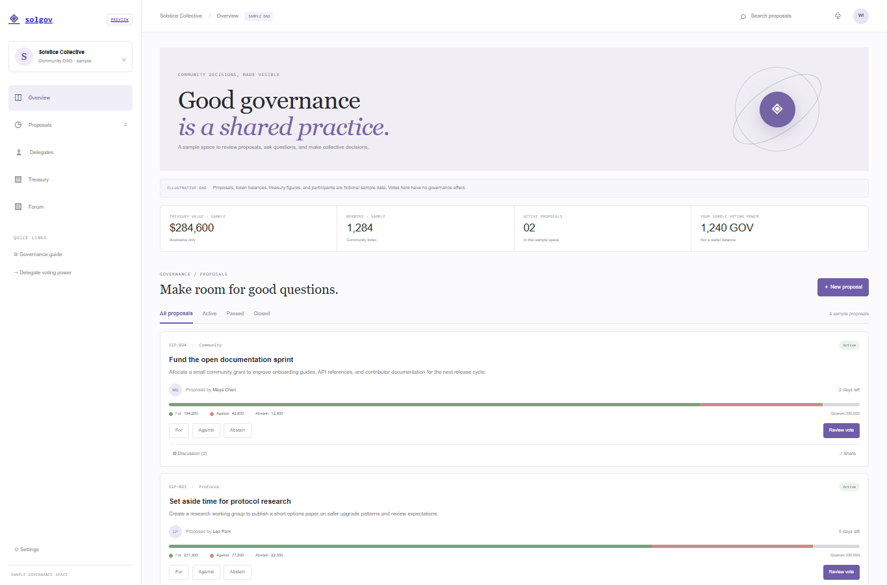

# SolGov

A DAO governance interface concept with fictional proposals, illustrative treasury/member figures, nonbinding vote interactions, proposal drafts, and local discussion notes.

## Run locally

From the workspace root, run `npm install`, then `npm run dev --workspace=solgov-dao` and open `http://localhost:3012`. For production, run `npm run build --workspace=solgov-dao` and `npm run start --workspace=solgov-dao`.

## Features

- Browse and filter proposals by status or search text.
- Choose a sample vote, record a local nonbinding vote, and see illustrative tallies update.
- Create a proposal draft and add local discussion notes.
- Responsive governance overview with an explicit sample-data banner.
- Anchor source in `programs/solgov` includes DAO and proposal initialization, one token-balance-weighted vote record per voter, quorum/majority checks, and treasury-transfer execution after a voting period.

## Scope and governance boundary

The browser demo is not connected to the Anchor source, a DAO, wallet, SPL Governance, MongoDB, or Solana RPC. Sample voting power, treasury values, tallies, and member references are fictional. Votes and discussions in the browser exist only in page memory and reset on reload. The Anchor source captures the voter token-account balance when the vote is cast; it has no historical snapshot or delegated voting. No program is deployed, and its configured ID is a development identifier without a generated deployment keypair.

## Anchor source

The Anchor workspace is pinned to 1.2.2 and targets localnet by default. With Rust, Solana/Agave tools, and Anchor 1.2.2 installed, run `cargo fmt --all`, `cargo test --workspace`, `cargo check --workspace`, and `anchor build --ignore-keys` from this directory. Anchor may create an ignored local build keypair under `target/`; it is not synced with the source ID and is not a deployment key. Before any Devnet deployment, generate an intentional program keypair, sync the program ID, and update the Anchor configuration to `Devnet`. This source has not been security-audited; do not fund the treasury with valuable assets. No deploy keypair, deployment, or Devnet transaction is included in this demo.

`cargo test --workspace` includes a local `solana-program-test` transaction flow for DAO and proposal creation, token-weighted voting, duplicate-vote rejection, treasury execution after the voting period, and replay rejection. It runs without a wallet or external RPC.

## Tech stack badges

   

## Screenshots

## Environment variables

No environment variables are required. This showcase uses local sample data and runs without paid APIs or external credentials.
